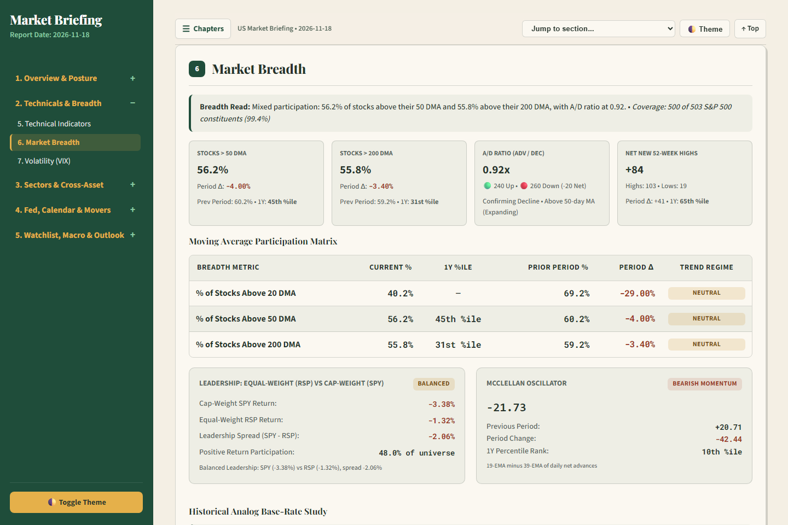
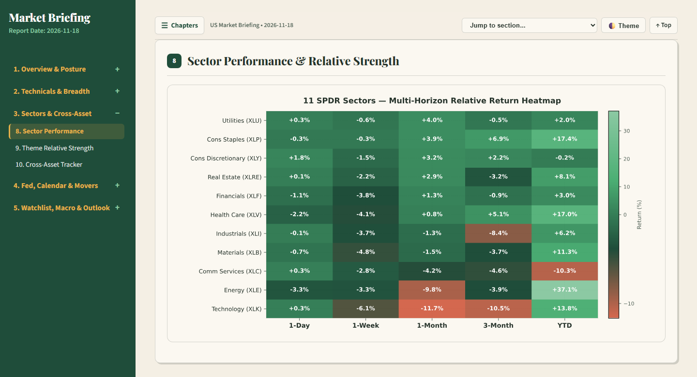
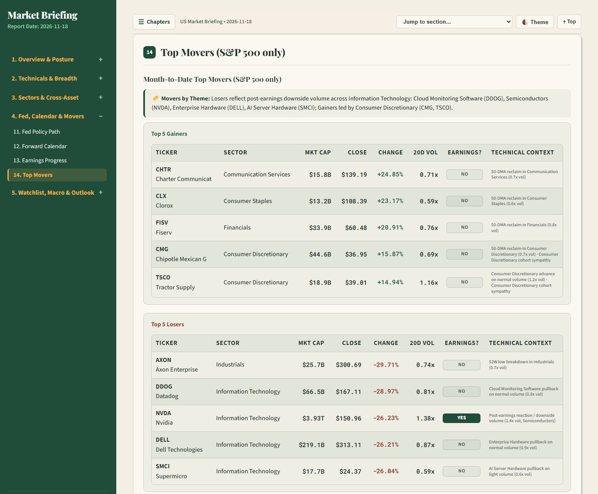

# Automated US Market Report Generator

A clean, modular Python quantitative platform engineered to generate automated **Daily**, **Weekly**, and **Monthly** US market reports in both GitHub-flavored **Markdown** and standalone, responsive **HTML** with light/dark mode support, publication-grade visual charts, automated scheduling, and MIME email delivery.

---

## ⚡ 10-Second Quickstart

Clone and run the automated launcher (automatically handles virtual environment setup, dependencies, and opens the daily report in your browser):

```bash
git clone https://github.com/DavidStojcev/swing-trading-market-report.git
cd swing-trading-market-report
./run.sh      # macOS / Linux
# or run.bat on Windows
```

> **Zero API Keys Required**: The platform runs out of the box using free public market feeds (`yfinance`). Optional FRED and Finnhub keys add live macro series and an economic calendar with consensus figures; without them those sections fall back to cached data or a built-in release schedule (static prior/consensus values).

---

## 🌐 Zero-Install Daily Web Dashboard (GitHub Pages)

Don't want to run Python locally? You can fork this repository to get your own free, automated daily market website:

1. Click **Fork** (top-right of this repository).
2. In your forked repo, go to **Settings** → **Pages**.
3. Under **Build and deployment**, set **Source** to **GitHub Actions**.
4. Every weekday at 21:30 UTC (at least 30 minutes after the NYSE close in both daylight-saving regimes), GitHub Actions generates the report and publishes the latest one live to:
   ```text
   https://<your-username>.github.io/<your-repo-name>/
   ```
5. Bookmark that URL on your phone or desktop for a fresh, interactive report every afternoon!
   *(You can also trigger a fresh report on-demand anytime from the **Actions** tab → **Run workflow**).*

---

## 📊 Report Showcase & Visual Preview

Each generated report is fully standalone (works offline with embedded fonts and vector graphics) and supports responsive light/dark themes. Daily reports are a compact 8-section brief; weekly and monthly reports are the full edition (19 sections, including the sector heatmap, theme strength, cross-asset tracker, Fed path, calendar, earnings and sentiment panels). The screenshots below are from a monthly report in the default light theme.

### Market Breadth & Internal Participation
S&P 500 constituent breadth: % of stocks above the 20/50/200 DMA (with 1-year percentile context), Advance/Decline ratio, Net 52-week Highs, the Cap-Weight vs. Equal-Weight leadership spread (`SPY` vs. `RSP`), and the McClellan Oscillator:



### Sector Multi-Horizon Relative Return Heatmap
All 11 Select Sector SPDR ETFs across five horizons (1-Day, 1-Week, 1-Month, 3-Month, and YTD) to identify capital rotation, momentum leadership, and tactical divergence. Weekly and monthly reports pair it with a ranked relative-strength table:



### Top Movers (S&P 500 only)
The five biggest gainers and losers for the period, restricted to S&P 500 constituents that pass the price (≥ $5), liquidity (≥ 1M shares/day) and market-cap (≥ $2B) filters. Each row shows sector, market cap, close, change, relative 20-day volume, whether the move followed an earnings release, and a short technical context note, with a theme summary above the tables:



Generated reports are automatically saved to:
- `reports/daily/YYYY-MM-DD.html` and `.md`
- `reports/weekly/YYYY-MM-DD.html` and `.md`
- `reports/monthly/YYYY-MM-DD.html` and `.md`

An `.eml` file is written next to them only when you pass `--dry-run-email` (or `--email`). Each run also writes a `qa_report.md` into the period folder (see [Built-in QA Harness](#-built-in-qa-harness)).

---

## 💻 CLI Usage

### Everyday Commands

```bash
# 1. Interactive Wizard (press Enter to run today's report and auto-open HTML)
python report.py

# 2. Daily Report (generate and open immediately in default browser)
python report.py -O

# 3. Weekly Report (Week-to-date vs. prior completed week)
python report.py -t weekly -O

# 4. Monthly Report (Month-to-date vs. prior completed month)
python report.py -t monthly -O

# 5. Historical Analysis (generate report for any past trading date)
python report.py -t daily -d 2026-10-15 -O

# 6. Analyze a Custom Stock Watchlist on the fly
python report.py --tickers NVDA,AAPL,TSLA,PLTR -O

# 7. Point to a Custom Watchlist CSV
python report.py -w watchlist.csv -O
```

### Advanced Automation Flags

| Flag | Description | Example |
| :--- | :--- | :--- |
| `-t, --type` | Select report frequency (`daily`, `weekly`, `monthly`) | `-t weekly` |
| `-d, --date` | Target date in `YYYY-MM-DD` format | `-d 2026-10-15` |
| `-O, --open` | Automatically open the generated HTML report in browser | `-O` |
| `-q, --quiet` | Suppress log messages, clean terminal progress only | `-q` |
| `--email` | Send report via SMTP to configured email recipients | `--email` |
| `--dry-run-email` | Create local `.eml` file with inline charts without sending | `--dry-run-email` |
| `--no-cache` | Force fresh download of market data, bypassing cache | `--no-cache` |
| `--if-scheduled-day`| Runs only if today is the scheduled report day (skips weekends/holidays) | `--if-scheduled-day` |

---

## ⚙️ Configuration & Customization

### 1. Optional API Keys & Email Delivery (`.env`)

To enable automated email delivery or macroeconomic data feeds (FRED, Finnhub):

```bash
cp .env.example .env
```

Open `.env` and fill in any settings you want to use:

```env
# Optional Macro Providers (falls back gracefully if omitted)
FRED_API_KEY=your_fred_api_key_here
FINNHUB_API_KEY=your_finnhub_api_key_here

# Optional Email Delivery (SMTP)
SMTP_HOST=smtp.gmail.com
SMTP_PORT=587
SMTP_USER=your_email@gmail.com
SMTP_PASSWORD=your_app_password
EMAIL_FROM=Market Report <your_email@gmail.com>
EMAIL_TO=recipient@example.com
```

### 2. Strategy & Scoring Customization (`config/config.yaml`)

You can customize weights, technical thresholds, chart dimensions, and universe filters directly in [`config/config.yaml`](config/config.yaml):
- **Indicator Weights**: Adjust the voting weights of Technical, Macro, and Breadth categories.
- **RSI / MACD / ADX Thresholds**: Modify overbought/oversold boundaries.
- **Filter Criteria**: Adjust minimum price (`≥ $5`), liquidity (`≥ 1M shares/day`), or market cap thresholds.

---

## 🧠 Trend Scoring Engine

The scoring engine groups indicators into five weighted categories. Each category scores in $[-1.0, +1.0]$ using continuous gradients (not hard +1/0/-1 cliffs), and the weighted sum becomes a five-band regime verdict. Weights and band edges live under `scorecard_categories` in [`config/config.yaml`](config/config.yaml).

| Category | Weight | What it scores |
| :--- | :---: | :--- |
| **Trend / Price** | 30% | Price vs. 50/200 DMA, 50/200 cross, MACD, ADX; the weaker of S&P 500 and Nasdaq-100 |
| **Market Breadth** | 20% | % above 50/200 DMA, net new highs, RSP vs. SPY leadership, A/D line, McClellan |
| **Rates & Macro** | 20% | 10Y/2Y yield shifts and trends, 2s10s curve, real yield (10Y TIPS), dollar (DXY), crude shock, inflation and labor dynamics |
| **Volatility & Risk** | 15% | VIX level and period shift, VIX term structure, high-yield credit spreads |
| **Sentiment & Positioning** | 15% | Put/call ratio, AAII bull-bear spread, implied vs. realized vol (VRP) |

- Categories with fewer than 2 valid inputs (e.g. a missing feed) are dropped and the remaining weights are renormalized; the report says which category was dropped and why.
- The verdict also reports borderline cases (within 0.03 of a band edge), category agreement, and how the verdict changes if each category is removed.
- Event risk (e.g. a high-impact release within the configured window) can cap the posture.

### Verdict Bands (normalized score)
- 🟢 **Risk-on**: score ≥ `+0.40`
- 🟩 **Constructive**: `+0.15` ≤ score < `+0.40`
- ⚪ **Neutral**: `-0.15` < score < `+0.15`
- 🟠 **Cautious**: `-0.40` < score ≤ `-0.15`
- 🔴 **Risk-off**: score ≤ `-0.40`

RSI(14) is shown as a caution flag (overbought > 70, oversold < 30) and does not vote.

---

## ✅ Built-in QA Harness

After rendering, `qa_checks.py` runs 15 automated checks (T1–T13, R3, U1) against the generated HTML and section data: label/vote consistency, a single source of truth for cross-section numbers, run-to-run stability, chart coverage, duplicate-text and cross-reference lint, calendar sourcing, arithmetic and sanity bounds, impersonal-language compliance, and a reading-time budget. Results are written to `reports/<type>/qa_report.md`, and a failing check fails the build, so a broken report is never published silently.

---

## ⏰ Automated Scheduling

### 1. Crontab (Local / Server)
Run automatically on trading days after the NYSE close (~4:30 PM ET):

```cron
# Daily report at 16:30 ET Mon-Fri (checks if active session)
30 16 * * 1-5 cd "/path/to/Market Report" && .venv/bin/python report.py -t daily --if-scheduled-day --email

# Weekly report at 17:00 ET Mon-Fri (runs only on week's final trading day)
00 17 * * 1-5 cd "/path/to/Market Report" && .venv/bin/python report.py -t weekly --if-scheduled-day --email

# Monthly report at 17:30 ET Mon-Fri (runs only on month's final trading day)
30 17 * * 1-5 cd "/path/to/Market Report" && .venv/bin/python report.py -t monthly --if-scheduled-day --email
```

### 2. GitHub Actions Workflow
The repository includes an automated workflow at [`.github/workflows/market_report.yml`](.github/workflows/market_report.yml):
- **Schedule**: Automatically runs at `21:30 UTC` Monday–Friday (≥ 30 minutes after the close in both EDT and EST). Each run generates the daily report and, on the last trading day of the week/month, the weekly/monthly report.
- **DST & Calendar Intelligence**: Uses `exchange_calendars` to handle daylight saving shifts, market holidays (Good Friday, Thanksgiving, Christmas), and early closes cleanly.
- **Data Caching**: Caches `.cache/` and `logs/` between runs to stay under Yahoo rate limits; a manual run can tick `refresh_cache` to re-download all price bars.
- **Artifacts & Publishing**: Publishes the latest HTML report to GitHub Pages and stores 30-day report artifacts. Scheduled runs create dry-run `.eml` files only; email is sent only if you trigger a manual run with `send_email` enabled.

---

## 🛠️ Manual Installation (For Developers)

```bash
# 1. Clone repository
git clone https://github.com/DavidStojcev/swing-trading-market-report.git
cd swing-trading-market-report

# 2. Set up virtual environment
python3 -m venv .venv
source .venv/bin/activate

# 3. Install dependencies
pip install -r requirements.txt
pip install -e .

# Or using uv (recommended for ultra-fast installs):
uv venv .venv
source .venv/bin/activate
uv pip install -e .
```

---

## 🏗️ Architecture & Directory Layout

```text
market_report/
├── .github/
│   └── workflows/
│       └── market_report.yml    # Scheduled GitHub Actions run & Pages deployment
├── config/
│   ├── config.yaml              # Symbols, scorecard weights/bands, thresholds, filters, email
│   └── settings.py              # Strongly-typed configuration loader
├── data/
│   ├── base.py                  # Abstract DataProvider interface
│   ├── yfinance_provider.py     # YFinance provider (Parquet cache, chunking, backoff, rate-limit breaker)
│   ├── constituents.py          # S&P 500 universe loader & local cache
│   ├── cache.py                 # Local Parquet OHLCV caching engine
│   ├── calendar.py              # NYSE calendar & period windows (daily/weekly/monthly)
│   ├── macro_base.py            # Abstract EconCalendarProvider interface
│   ├── fred_provider.py         # FRED client (yields, spreads, TIPS) with JSON caching
│   ├── calendar_provider.py     # Finnhub economic & earnings calendar (built-in schedule fallback)
│   ├── cot_provider.py          # CFTC Commitments of Traders positioning
│   ├── fomc.py                  # FOMC rate target and meeting schedule
│   ├── model_accountability.py  # Tracks past verdicts vs. realized outcomes
│   └── cache/                   # Committed JSON caches (CAPE valuation, COT, accountability)
├── delivery/
│   └── email_sender.py          # SMTP TLS delivery, inline CID charts, and .eml export
├── indicators/
│   ├── moving_averages.py       # 20/50/200 DMA & Golden/Death cross detection
│   ├── momentum.py              # RSI(14) using Wilder's smoothing
│   ├── trend.py                 # MACD(12,26,9) & ADX(14) with +DI/-DI
│   ├── breadth.py               # S&P 500 breadth (% above MAs, A/D, 52W H/L, RSP vs SPY, McClellan)
│   └── engine.py                # Unified technical computation (frozen TechnicalSnapshot)
├── scoring/
│   ├── rules.py                 # Gradient scoring rules for the five scorecard categories
│   └── engine.py                # Category weighting, regime verdict, sensitivity, explainability
├── sections/                    # One module per report section; each returns a SectionResult
│   ├── base.py                  # SectionResult + CanonicalFactsRegistry (cross-section source of truth)
│   ├── executive_summary.py, what_changed.py, swing_regime.py, index_snapshot.py
│   ├── technicals.py, breadth.py, volatility.py
│   ├── sectors.py, theme_relative_strength.py, commodities_cross_asset.py
│   ├── fed_path.py, forward_calendar.py, earnings.py, macro.py
│   ├── movers.py, watchlist.py, sentiment_positioning.py
│   ├── valuation.py, historical_analog.py
│   └── conclusion.py            # Scorecard summary and outlook
├── storage/
│   └── snapshots.py             # SQLite state store for period-over-period deltas
├── render/
│   ├── charts.py                # Matplotlib chart generator (PNG, used for email)
│   ├── svg_charts.py            # Inline SVG charts for the HTML report
│   ├── markdown.py              # Markdown report formatter
│   ├── html.py                  # Standalone HTML report (embedded CSS, fonts, charts)
│   └── fonts/                   # Fonts embedded into the HTML
├── reports/                     # Generated output: reports/{daily|weekly|monthly}/ (git-ignored)
├── tests/                       # Test suite (calendar, indicators, scoring, sections, rendering, QA)
├── qa_checks.py                 # Post-generation QA harness (writes qa_report.md)
├── report.py                    # Main CLI, interactive wizard, and report orchestrator
├── pyproject.toml               # Package build configuration and CLI entry points
├── requirements.txt             # Project dependencies (minimum versions)
└── run.sh / run.bat             # One-click quickstart launchers
```

---

## 🧪 Unit Testing

Run the comprehensive test suite with `pytest`:

```bash
pytest -v
```

The test suite covers:
- **Trading Calendar**: NYSE/NASDAQ calendar, holiday checks, weekend detection, scheduled day triggers.
- **Technical Indicators**: 20/50/200 DMA, Golden/Death crosses, Wilder's smoothed RSI(14), MACD(12,26,9), ADX(14).
- **Macro & Rates**: Inflation MoM/YoY calculations, Nonfarm Payroll surprises, Real GDP QoQ, yield spread inversion.
- **Market Breadth**: % above MAs, Advance/Decline counts, McClellan Oscillator, Net 52-week Highs/Lows.
- **Scoring & Sections**: Category scorecard, regime verdicts, section builders, and cross-section consistency.
- **Charts & Reports**: Headless Matplotlib chart rendering, HTML/Markdown generation, QA checks, and MIME email builder.

---

## 📜 License

This project is licensed under the [MIT License](LICENSE).

---

## ⚖️ Legal & Financial Disclaimer

> [!IMPORTANT]
> **NOT FINANCIAL ADVICE. FOR EDUCATIONAL AND INFORMATIONAL PURPOSES ONLY.**
> 
> * **No Investment Advice**: This software and its generated reports are designed purely for informational, research, and educational purposes. Nothing contained herein constitutes investment, financial, trading, accounting, or legal advice, nor does it constitute a recommendation, endorsement, or solicitation to buy, sell, hold, or trade any security, derivative, commodity, or financial instrument.
> * **No Warranty & Limitation of Liability**: The software is provided "as is", without warranty of any kind, express or implied. Under no circumstances shall the authors, contributors, or copyright holders be held liable for any direct, indirect, incidental, consequential, special, or exemplary damages, or any financial losses, lost profits, or business interruption.
> * **Risk of Trading**: Trading in equities, options, futures, and other financial instruments involves substantial risk of loss and is not suitable for every investor. Users must conduct their own independent due diligence and consult with a licensed professional financial adviser before making any investment decisions.
> * **Third-Party Data & Trademarks**: Market data is retrieved via third-party providers (`yfinance`, FRED, Finnhub, CFTC). Users are solely responsible for obtaining their own API keys and complying with the respective providers' Terms of Service. All product names, logos, index names (e.g., S&P 500®, Nasdaq-100®, Russell 2000®, Cboe VIX®), and trademarks belong to their respective owners.
